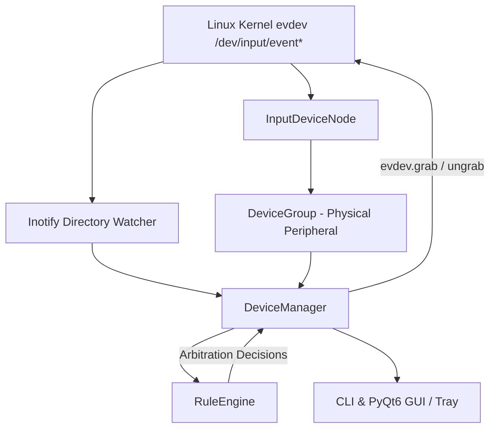

# InputGate Architecture Specification

## Overview
InputGate operates as a user-space daemon and desktop interface that monitors Linux input event nodes (`/dev/input/event*`) and applies priority and silence rules without requiring root permissions.

## Core Layers

### 1. Hardware Representation Layer
- **InputDeviceNode**: Represents an individual `/dev/input/eventX` device node.
- **DeviceGroup**: Bundles all event nodes sharing the same physical hardware parent (e.g. mouse + consumer control + keyboard macro nodes for a single mouse).
- **Classification**: Detects whether a peripheral is a Mouse, Keyboard, Touchpad, or Other via evdev capabilities.

### 2. State & Arbitration Layer
- **RuleEngine**:
  - `detect_dual_pairs()`: Finds wireless receivers and wired siblings sharing vendor/model signatures.
  - `compute_desired_mutes()`: Evaluates active policies (Wired Priority, Wireless Priority, Laptop Exclusion, Lockout).
- **DeviceManager**: Orchestrates scanning, hotplug lifecycle, thread-safe locking, and synchronization between desired mutes and live `evdev.grab()` states.

### 3. Presentation Layer
- **CLI**: Rapid inspection, one-click manual toggling, and headless systemd daemon mode.
- **GUI (PyQt6)**: Multi-tab desktop manager with system tray indicator, per-device cards, and cleaning lock countdown modal.
